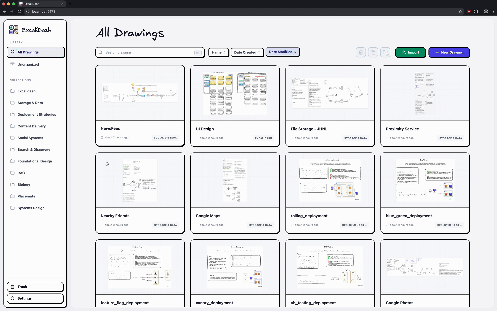
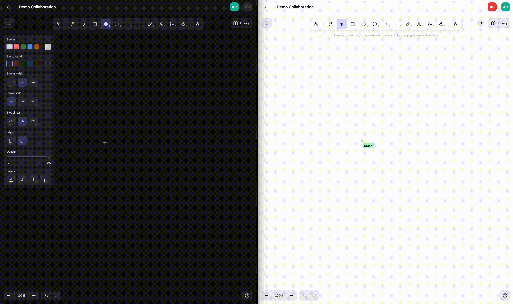
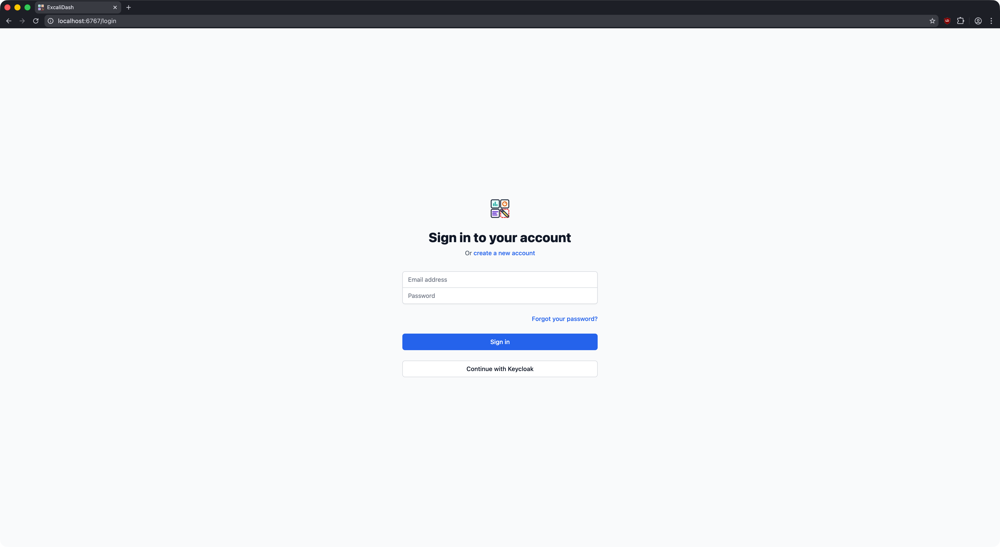
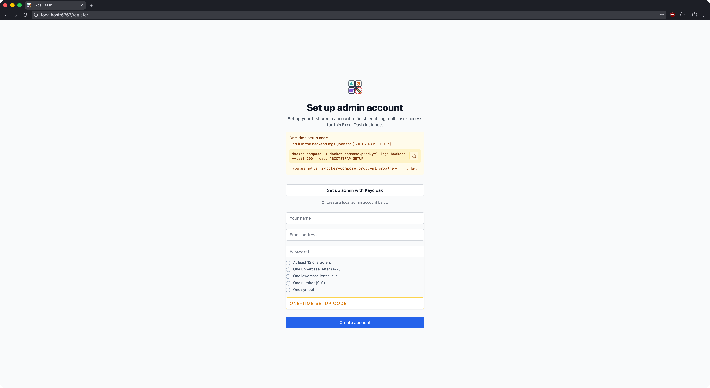
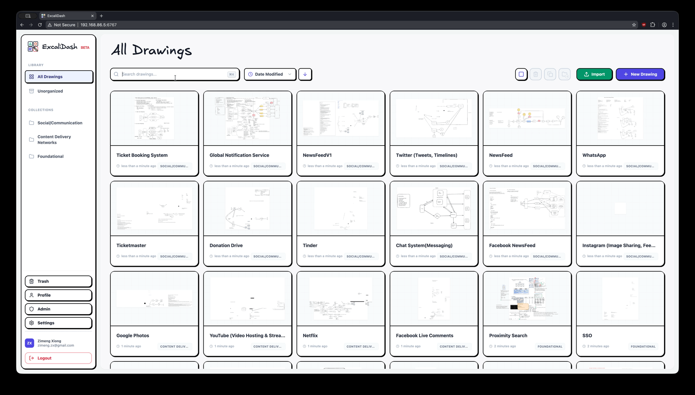
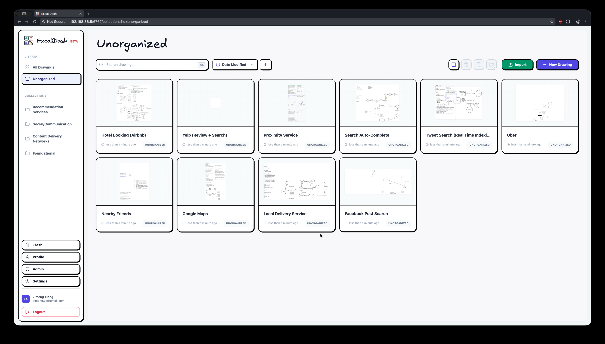
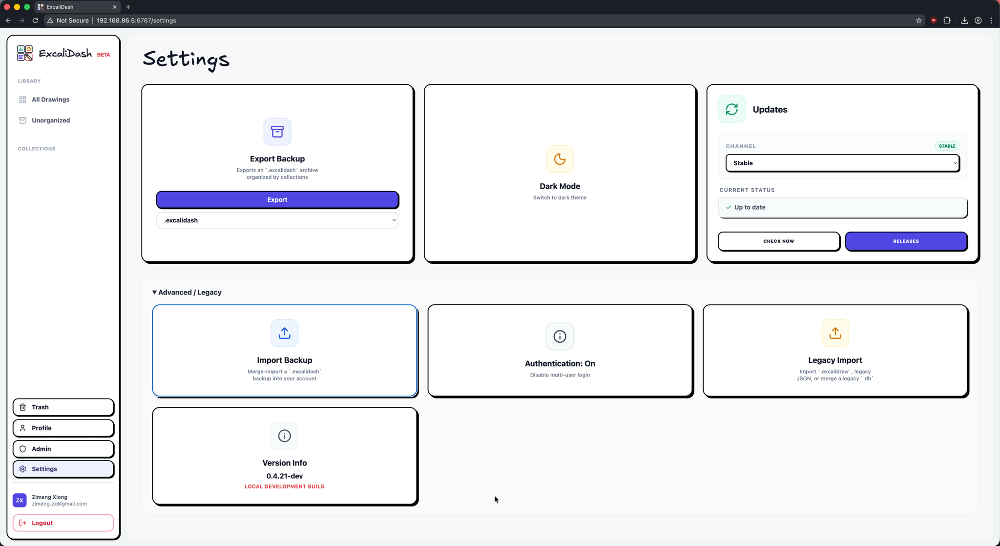

# ExcaliDash

Every downstream production frontend image built from this repository serves
the corresponding source bundle for that exact build at
`/source/excalidash-source.tar.gz`.

[](https://github.com/Click-Hype/NooviCrew-Excalidash/actions/workflows/test.yml)
[](LICENSE)

[](https://github.com/Click-Hype/NooviCrew-Excalidash/pkgs/container/noovicrew-excalidash-backend)

A self-hosted dashboard and organizer for [Excalidraw](https://github.com/excalidraw/excalidraw) with live collaboration features.

This repository is a Click-Hype / NooviCrew downstream distribution of
[ZimengXiong/ExcaliDash](https://github.com/ZimengXiong/ExcaliDash). It retains
the upstream project and contributor credits and is licensed under
[AGPL-3.0-only](LICENSE); see [NOTICE](NOTICE) for attribution details.



## Table of Contents

- [Features](#features)
- [Upgrading](#upgrading)
- [Installation](#installation)
  - [Quickstart](#quickstart)
  - [Advanced](#advanced)
- [Development](#development)
- [Credits](#credits)

## Features

<details>
<summary>Persistent storage for all your drawings</summary>

Drawings remain available across restarts and can be organized in nested
folders and subfolders.

</details>

<details>
<summary>Real time collaboration</summary>



</details>

<details>
<summary>Version history and restore</summary>

Automatically retain recent drawing snapshots, preview past versions from the editor, and restore a previous state when needed.

</details>

<details>
<summary>(Optional) Multi User Authentication, OIDC Support</summary>

### Sign in with OIDC



### Migration from v0.3

Existing installations can migrate through the guided onboarding flow after a
database backup.

### Admin Bootstrap



### Admin Dashboard

Administrators can manage users, application access and deployment settings.

</details>

<details>
<summary>Scoped internal & external sharing</summary>

Share individual canvases or folder trees with explicit view/edit permissions.

</details>
<details>
<summary>Search your drawings</summary>



</details>

<details>
<summary>Drag and drop drawings into collections</summary>



</details>

<details>
<summary>Nested folders and subfolders</summary>

Organize drawings in a folder tree. Exports preserve parent/child relationships,
and imports remain compatible with older backups that only contain top-level
collections.

</details>

<details>
<summary>Export/import your drawings for backup</summary>

### Excalidash uses a non-proprietary archival format that stores your drawings in plain .excalidraw format



</details>

# Upgrading

See [release notes](https://github.com/Click-Hype/NooviCrew-Excalidash/releases) for a specific release.

ExcaliDash includes an in-app update notifier that checks GitHub Releases. If your deployment must not make outbound network calls, disable it on the backend:

```bash
UPDATE_CHECK_OUTBOUND=false
```

## Docker image upgrades

`docker-compose.prod.yml` is pinned to a stable release instead of `:latest`.
Before an upgrade, back up the database and private `.env`, then change both
`EXCALIDASH_*_IMAGE` values in `.env` to the same tested release tag:

```bash
./scripts/production-preflight.sh
docker compose -f docker-compose.prod.yml pull
docker compose -f docker-compose.prod.yml up -d --wait
docker compose -f docker-compose.prod.yml ps
./scripts/production-smoke.sh
```

Do not use `down` for a normal upgrade. Recreating the services in place reduces
downtime and leaves the named data volumes attached. To roll back application
images, restore the previous two image references in `.env` and run:

```bash
docker compose -f docker-compose.prod.yml pull
docker compose -f docker-compose.prod.yml up -d --wait
./scripts/production-smoke.sh
```

Notes:

- Don’t add `-v` to `down` unless you intend to delete the persistent backend volume (your SQLite DB + secrets).
- Only add `--remove-orphans` if you previously ran a different Compose file for the same project name and need to remove old/renamed services.
- If an upgrade contains a non-backward-compatible database migration, rolling
  back the image also requires restoring the pre-upgrade database backup.

# Installation

> [!CAUTION]
> This is a BETA deployment and production-readiness depends on deployment controls:
> use TLS, trusted reverse proxy, fixed secrets, backups, and endpoint rate limits.

> [!CAUTION]
> ExcaliDash is in BETA. Please backup your data regularly.

## Quickstart

Prereqs: Docker + Docker Compose v2.

<details>
<summary>Published containers (recommended)</summary>

## Published containers (recommended)

Stable downstream images are published for each release in GitHub Container
Registry as `ghcr.io/click-hype/noovicrew-excalidash-backend` and
`ghcr.io/click-hype/noovicrew-excalidash-frontend`. The production Compose file
pins both services to the same version.

```bash
# Download docker-compose.prod.yml
curl -OL https://raw.githubusercontent.com/Click-Hype/NooviCrew-Excalidash/main/docker-compose.prod.yml

# From a repository checkout, generate a private production environment.
./scripts/init-production-env.sh

# Review .env (especially FRONTEND_URL and TRUST_PROXY), then validate it.
./scripts/production-preflight.sh

# Pull the pinned images and wait for healthy containers.
docker compose -f docker-compose.prod.yml pull
docker compose -f docker-compose.prod.yml up -d --wait

# Verify both the frontend and the proxied backend health endpoint.
./scripts/production-smoke.sh
```

If you downloaded only the Compose file, also download the three scripts under
`scripts/`, or create `.env` yourself with fixed `JWT_SECRET`, `CSRF_SECRET`, and
`API_KEY_HASH_PEPPER` values of at least 32 random characters. The initializer
generates those values with OpenSSL and writes `.env` with mode `0600`.

Keep `API_KEY_HASH_PEPPER` stable after issuing agent/API keys. Changing it
invalidates all existing keys. To pin immutable digests, set the complete image
references in `.env`:

```bash
EXCALIDASH_BACKEND_IMAGE=ghcr.io/click-hype/noovicrew-excalidash-backend:0.6.0@sha256:<digest>
EXCALIDASH_FRONTEND_IMAGE=ghcr.io/click-hype/noovicrew-excalidash-frontend:0.6.0@sha256:<digest>
```

By default, the provided Compose files set `TRUST_PROXY=false` for safer setup. Only set `TRUST_PROXY` to a positive hop count (for example, `1`) when requests always pass through a trusted reverse proxy that correctly sets forwarded headers.

</details>

<details>
<summary>Docker Build</summary>

## Docker Build

```bash
# Clone the repository (recommended)
git clone git@github.com:Click-Hype/NooviCrew-Excalidash.git

# or, clone with HTTPS
# git clone https://github.com/Click-Hype/NooviCrew-Excalidash.git

docker compose build
docker compose up -d

# Access the frontend at localhost:6767
```

</details>

## Advanced

The root README keeps the install path short. See
[advanced deployment and operations](docs/DEPLOYMENT.md) for reverse proxy,
auth/OIDC, database provider, offline, backup, password policy, and operational
details.

For release-candidate validation across multiple local configurations, see the
[configuration lab](docs/CONFIG_LAB.md).

# Development

For contributor workflow, `make dev` starts the app in local single-user mode so you can reproduce editor bugs without going through login/onboarding. Use `make dev-auth` if you need to test local auth or OIDC flows from your `backend/.env`.

<details>
<summary>Clone the Repository</summary>

## Clone the Repository

```bash
# Clone the repository (recommended)
git clone git@github.com:Click-Hype/NooviCrew-Excalidash.git

# or, clone with HTTPS
# git clone https://github.com/Click-Hype/NooviCrew-Excalidash.git
```

</details>

<details>
<summary>Frontend</summary>

## Frontend

```bash
cd ExcaliDash/frontend
npm install

# Copy environment file and customize if needed
cp .env.example .env

npm run dev
```

</details>

<details>
<summary>Backend</summary>

## Backend

```bash
cd ExcaliDash/backend
npm install

# Copy environment file and customize if needed
cp .env.example .env

# Generate Prisma client and setup database
npx prisma generate
npx prisma db push

npm run dev
```

</details>

<details>
<summary>Simulate Auth Onboarding (Development)</summary>

### Simulate Auth Onboarding (Development)

To simulate first-run authentication choice flows in local development:

```bash
cd ExcaliDash/backend

# Preview what would change (no data modifications)
npm run dev:simulate-auth-onboarding:dry-run

# Simulate "fresh install" onboarding state
# (wipes drawings/collections/libraries and removes non-bootstrap users)
npm run dev:simulate-auth-onboarding:fresh

# Simulate "migration" onboarding state (ensures legacy data exists)
npm run dev:simulate-auth-onboarding:migration
```

After running a simulation while the backend is already running, wait about 5 seconds
(auth mode cache TTL) or restart the backend before refreshing the UI.

</details>

<details>
<summary>Setup and Operational Scripts</summary>

### Setup and Operational Scripts

In `backend/package.json` there are helper scripts for maintenance:

| Script          | Purpose                                    |
| --------------- | ------------------------------------------ |
| `admin:recover` | Emergency admin credential recovery/reset. |

Admin recovery example:

```bash
cd backend
npm run admin:recover -- --identifier admin@example.com --generate --activate --must-reset
```

Common flags:

| Flag                          | Description                                              |
| ----------------------------- | -------------------------------------------------------- |
| `--password "<new-password>"` | Set explicit new password.                               |
| `--generate`                  | Generate a secure random password.                       |
| `--activate`                  | Activate the admin account immediately.                  |
| `--promote`                   | Promote user to admin role.                              |
| `--must-reset`                | Force password reset on first login.                     |
| `--disable-login-rate-limit`  | Temporarily disable login throttling for this operation. |

</details>

# Credits
- Original project: [ZimengXiong/ExcaliDash](https://github.com/ZimengXiong/ExcaliDash).
- If you find the upstream project useful, consider [sponsoring Zimeng Xiong](https://github.com/sponsors/ZimengXiong).
- Example designs from:
  - <https://github.com/Prakash-sa/system-design-ultimatum/tree/main>
  - <https://github.com/kitsteam/excalidraw-examples/tree/main>
- [The amazing work of Excalidraw & contributors](https://www.npmjs.com/package/@excalidraw/excalidraw)
